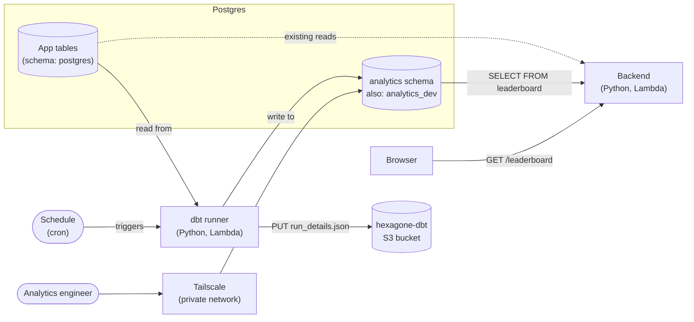

# Analytics architecture

Converted from [`analytics-architecture.excalidraw`](archive/analytics-architecture.excalidraw), titled "Analytics DX" and drawn in March 2026.

> **Status: plan, not built.** This sketches how dbt would build analytics tables inside the app's own Postgres database, and how the app would serve a leaderboard from them. It was drawn for the earlier AWS setup (Lambda functions, S3), so the hosting pieces need re-planning for the Mac mini. The idea itself still stands: it is the "Analytics Project Setup" epic on the roadmap.

## The plan as drawn

How to read it:

- **Building the models.** On a schedule, a dbt runner reads the app's tables, builds models, and writes them to an `analytics` schema in the same Postgres database. It saves a `run_details.json` file for each run to an S3 bucket called `hexagone-dbt`, a record of what ran and when.
- **Serving them.** The backend gains a `GET /leaderboard` endpoint that reads straight from `analytics.leaderboard`. The dotted line is the backend's normal reads from the app tables, which already existed.
- **Developing them.** An analytics engineer connects to the database over Tailscale and builds in an `analytics_dev` schema, so work in progress never touches the tables the app serves.

## What would change for the Mac mini

| Part | As drawn | Likely replacement |
| --- | --- | --- |
| Backend | AWS Lambda | The FastAPI server on k3s; `GET /leaderboard` would be a new endpoint backed by a view or table |
| dbt runner and schedule | Lambda on a cron schedule | A Kubernetes CronJob, like the existing 6-hourly backup job (`infra/k8s/base/app/db-backup.yaml`) |
| Run details bucket | S3 `hexagone-dbt` | A Tigris bucket, created in `infra/terraform/storage.tf` |
| Developer access | Tailscale to the AWS database | Tailscale to the Mac mini, which is already how the admin reaches it |

None of this exists in the repo yet. The unmerged `dbt-database-access` branch has database-access notes for the old AWS database.
