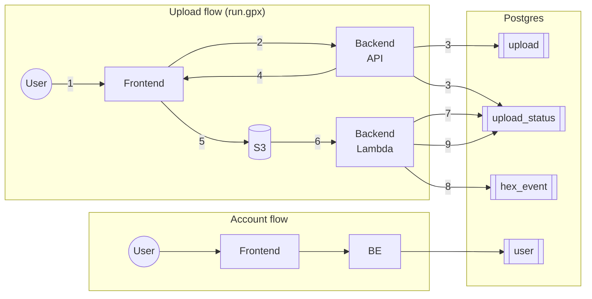
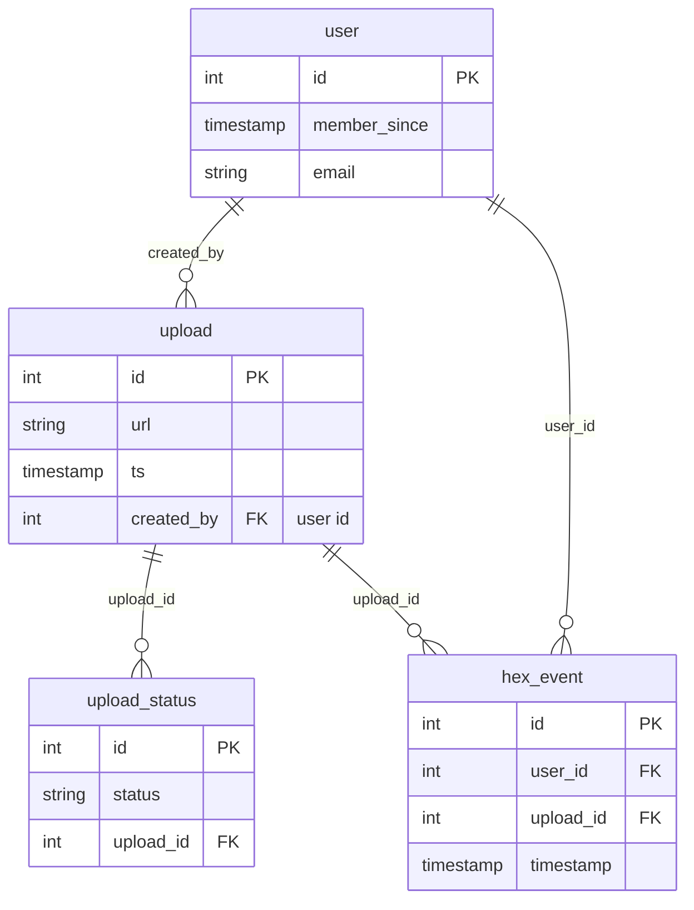

# GPX Upload System — Architecture

This document captures the system for uploading `.gpx` files and creating user
accounts. It contains three things:

1. A **flowchart** of the request / data flow
2. An **ER diagram** of the Postgres schema
3. A **step-by-step legend** explaining the numbered upload flow

The arrows in the flowchart carry only step numbers; the legend below explains
what each one means. The database is **Postgres**.

---

## 1. Request / data flow

---

## 2. Database schema (Postgres)

---

## 3. Upload flow — step by step

The arrows in the flowchart are numbered to show the order things happen when a user uploads a file.

| Step | What happens | In plain terms |
|------|--------------|----------------|
| **1** | User interacts with the frontend | The user clicks through the webpage to upload `run.gpx` |
| **2** | Frontend -> Backend API (**HTTP request**) | Frontend asks the backend API where to put the file |
| **3** | Backend API -> DB | Backend creates an `upload` record and adds an `upload_status` row marked *pending*|
| **4** | Backend API -> Frontend (**HTTP response**) | Backend API replies with the URL to use |
| **5** | Frontend -> S3 | Frontend uploads the file to the location the URL points to |
| **6** | S3 -> Backend Lambda | The file landing in S3 triggers the backend's Python code |
| **7** | Backend Lambda -> DB | Adds an `upload_status` row marked *received* |
| **8** | Backend Lambda -> DB | Creates a `hex_event` record |
| **9** | Backend Lambda -> DB | Adds an `upload_status` row marked *success* or *fail* |

### Notes

- **HTTP request / response (steps 2 & 4):** These are the two halves of one
  round trip. The frontend opens the exchange with a *request* asking where to
  upload the file; the backend replies on the same connection with a *response*
  carrying the URL. "HTTP" names the protocol both sides use to talk; "HTTPS"
  (in the account flow) is the secure version of that same protocol.
- **`upload_status` as a lifecycle log:** This table is written to repeatedly —
  *pending* (step 3), *received* (step 7), then *success* / *fail* (step 8) —
  so it acts as a running record of where each upload is in its lifecycle.
- **Direct browser -> S3 upload (step 5):** The file goes from the frontend
  straight to S3 using the URL from step 4, not through the backend. This is a
  common pattern and keeps large file transfers off the backend.

### Terminology quick reference

- **Frontend / client:** the part of the app the user sees and interacts with. A web frontend is one kind of client.
- **Backend (BE):** the server-side code that does the work behind the scenes.
- **Request:** a message the frontend sends asking the backend to do something or return information.
- **Response:** the backend's reply to a request.