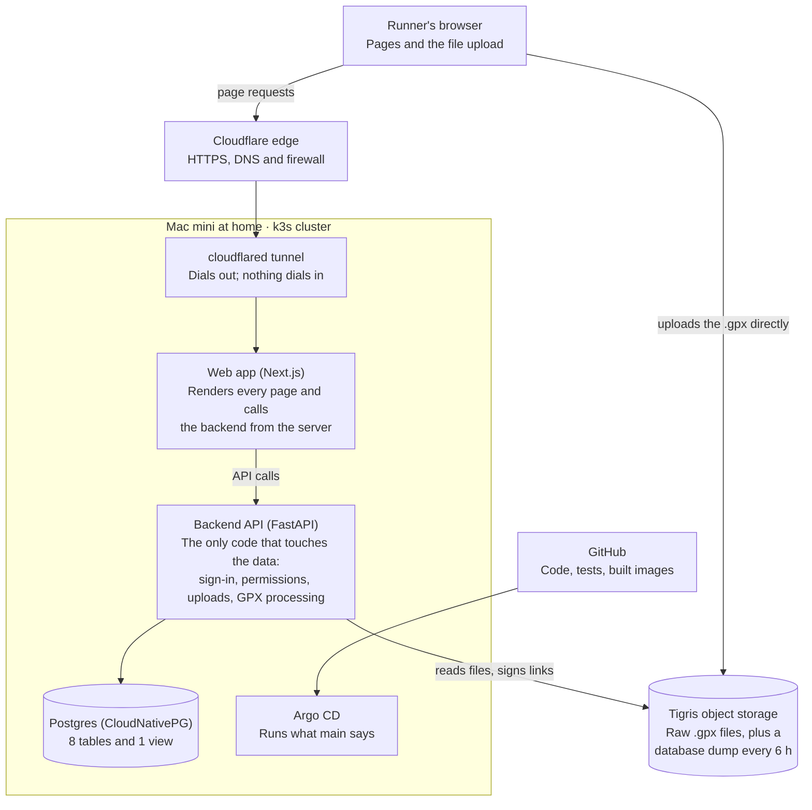

# Hexagone, explained for an analytics engineer

Last updated: 2026-11-12

## The short version

Hexagone is a web app that turns your runs into territory on a map. You upload the GPS file from a run, and every loop your route closes is filled with hexagons that become "yours". The map then shows all the hexagons you have claimed.

It is invite-only today: a short allowlist of email addresses can sign in, and the landing page offers "Request early access". Production runs on a Mac mini, reached through Cloudflare.

For an analytics engineer, the easiest way in is to treat Hexagone as a small event pipeline with an app on each end:

- **Source:** a `.gpx` file (an XML log of GPS points with timestamps) exported from a watch or running app.
- **Transform:** Python code finds the closed loops in the route and converts each one into a set of hexagon IDs.
- **Fact table:** one row per hexagon claimed, in a Postgres table called `hex_claim`.
- **Aggregate:** a SQL view, `hex_claim_by_cell`, rolls that up to one row per user per hexagon.
- **Consumer:** the map page, which reads the aggregate through an API rather than querying the database directly.

Most of the code that is not in that pipeline exists to keep it safe and running: sign-in, permissions, file storage, deployment and monitoring. The plan is to build on this code, not rewrite it, so "Areas of work" below says which parts to learn and which to treat as a black box.

**A note on the repo's own docs.** The upload section of `README.md` still describes an older AWS setup (S3 plus Lambda functions). That was removed on 11–12 June 2026. This explainer follows the current code on `main`.

## The big picture

Production is one Mac mini at home running the web app, the backend and Postgres, with Cloudflare in front and Tigris holding the files.



Read it top to bottom: a page request passes through Cloudflare and the tunnel to the web app, which asks the backend, which queries Postgres. The one shortcut is the upload: the browser sends the file straight to Tigris, using a link the backend signed. Not shown: Resend, the service that emails sign-in links.

On a laptop the same pieces run under Docker, with SeaweedFS standing in for Tigris and no Cloudflare.

## Areas of work

The repo splits into 12 areas. Building on it means working in three of them (uploads, the map, the data model) and treating the rest as finished parts you call into. Change the depth column as your plans change.

Backend paths below are relative to `apps/backend/src/app/`; web paths to `apps/web/`.

| Area | What it covers | Main folders | Depth needed |
| --- | --- | --- | --- |
| Uploads and GPX processing | Getting a run file in and turning it into hexagons | `routers/uploads.py`, `services/upload.py`, `services/gpx.py`; web `features/uploads/` | Work in it |
| Map and hexagon data | Reading claimed hexagons back and drawing them | `routers/hex_claims.py`, `repository/views.py`; web `features/hexMap/` | Work in it |
| Data model and migrations | Tables, views, and changing them safely | `repository/`, `apps/backend/src/alembic/versions/` | Work in it |
| Groups | Named groups of users, backend only so far | `routers/user_groups.py`, `services/user_group.py` | Know the outline |
| Landing page, onboarding, app shell | Public home page, first-run welcome, nav and styling | web `app/`, `features/landing/`, `features/onboarding/`, `src/styles/` | Know the outline |
| Web-to-backend contract and config | How the web app calls the API; settings | `main.py`, `settings.py`; web `src/__generated__/`, `src/config/` | Know the outline |
| Tests and automated checks | What runs on every commit and pull request | `apps/backend/tests/`, `lefthook.yml`, `.github/workflows/pr-checks.yml` | Know the outline |
| Local development setup | Running everything on a laptop | `docker-compose.yml`, `scripts/local-db-ops.sh` | Know the outline |
| Sign-in and sessions | Who you are and keeping you signed in | `routers/login_tokens.py`, `routers/user_sessions.py`, `services/login_token.py`; web `features/auth/` | Leave alone |
| Production hosting and deploys | Running it on the Mac mini and shipping changes | `infra/`, `.github/workflows/deploy.yml`, `scripts/prod-stack.sh` | Leave alone |
| Logging and tracing | Records of what happened, with personal data masked | `utils/logger.py`, `telemetry.py` | Leave alone |
| Project tooling | Rules for Claude Code, task tracking, design files | `CLAUDE.md` files, `.claude/skills/`, `resources/` | Leave alone |

### Uploads and GPX processing

The backend reserves a slot and hands the browser a temporary upload link; the browser sends the file to storage; `process_upload` turns it into `hex_claim` rows. "How data moves through it" below walks through each step. The missing trigger for `process_upload` is the first job.

- **Backend:** `routers/uploads.py` (reserve a slot, list uploads), `services/upload.py` (status changes, `process_upload`), `services/gpx.py` (find loops, convert to hexagons), `services/storage.py` (talks to file storage).
- **Web:** `app/(authed)/uploads/` and `features/uploads/` (upload button, modal, progress, list).
- **Storage:** SeaweedFS locally (`docker-compose.yml`, `scripts/seaweedfs-init.sh`); the Tigris bucket in production (`infra/terraform/storage.tf`).
- **Handy for experiments:** `scripts/gpx_to_h3.py`, a standalone copy of the loop-to-hexagon algorithm.
- **Tests:** `apps/backend/tests/app/services/test_upload.py`, `test_gpx.py`, `tests/app/routers/test_uploads.py`.

### Map and hexagon data

The map page fetches the signed-in user's rows from `hex_claim_by_cell` and draws each hexagon over a street map. Leaderboards and "hottest hexes" will mostly be new views and endpoints in this area.

- **Backend:** `routers/hex_claims.py` (`/hex-claims` for raw rows, `/aggregated-hex-claims` for one row per hexagon), `services/hex_claim.py`, `repository/views.py`.
- **Web:** `app/(authed)/map/` and `features/hexMap/` (`HexMap`, plus `EmptyMap` shown before the first upload).

### Data model and migrations

Tables are Python classes. Changing one also needs a migration file, so the database changes to match. The process is: edit `models.py`, run `uv run alembic revision --autogenerate -m "0007_description"`, check the generated file, run the tests. One new migration per pull request; production applies it automatically before the backend starts.

- **Tables and views:** `repository/models.py`, `repository/views.py`.
- **Migrations:** `apps/backend/src/alembic/versions/`.
- **Querying:** `repository/repository.py` and `predicates.py` build queries from filters. The house rule is to add a filter here rather than write raw SQL in a service.
- **Who sees what:** `services/permissions.py` adds the "only your own rows" filter to every query.

### Groups

Users can create, rename and archive groups, and add or remove members, through the API. There are no screens for it yet. It is groundwork for group leaderboards.

- **Backend:** `routers/user_groups.py`, `services/user_group.py`. **Tables:** `user_group`, `user_group_membership`.

### Landing page, onboarding and app shell

The public home page shows an animated run tracing a loop. After a first sign-in, `/welcome` nudges people to upload a run. The nav bar and page layout wrap everything.

- **Web:** `app/page.tsx` and `features/landing/`; `app/(authed)/welcome/` and `features/onboarding/`; `app/Nav.tsx`, `app/layout.tsx`.
- **Styling:** `src/styles/theme.css` (colours, fonts, spacing) and `src/styles/main.css`.
- **Rules to know:** one folder per feature, and features may not import from each other. Automated checks enforce both, and Claude Code follows them from `CLAUDE.md`.

### Web-to-backend contract and config

The backend publishes a description of every endpoint. A tool called Orval turns it into ready-made functions, such as `listAggregatedHexClaims()`, that the web app calls. Both are regenerated on every commit, so a renamed column breaks the web build at once, like a dbt model contract. Settings live in one typed file per app; a missing or malformed value stops the app starting.

- **Backend:** `main.py` (lists every set of endpoints), `settings.py` (all backend settings and their defaults), `apps/backend/__generated__/openapi.json`.
- **Web:** `src/__generated__/` (never edit by hand), `orval.config.ts`, `src/lib/fetch-client.ts`, `src/config/env.ts`.

### Tests and automated checks

Every commit runs ten checks on your laptop, and every pull request re-runs them on GitHub along with both test suites. A failing check usually says what to fix, and Claude Code can fix most of them.

- **Tests:** `apps/backend/tests/`; web tests sit next to the file they test (`*.test.tsx`).
- **Checks:** `lefthook.yml` (on commit), `.github/workflows/pr-checks.yml` (on pull request), `apps/web/scripts/check-imports.mjs` and `check-app-structure.mjs` (folder rules), `apps/backend/src/scripts/validate_migrations.py`.

### Local development setup

One file defines the six local services. A script migrates or wipes the local database. Example settings files list what each app expects.

- `docker-compose.yml`, `scripts/local-db-ops.sh`, `scripts/seaweedfs-init.sh`, `apps/backend/.env.example`, `apps/web/.env.example`.

### Sign-in and sessions

There are no passwords. Someone enters their email; if it is on the allowlist, they get a one-time link valid for 10 minutes. Opening it in the same browser signs them in, and a cookie keeps them signed in. Everything else in the app only asks "who is this?" and gets a user back.

You would touch it only to change who may sign in (the `ALLOWED_EMAILS` setting) or to finish removing the old password code (TASK-0021).

- **Backend:** `routers/login_tokens.py`, `routers/user_sessions.py`, `routers/users.py`; `services/login_token.py`, `user_session.py`, `user.py`, `email.py`, `password.py` (old, due for removal); `dependencies.py`, where `authenticated_user` is the one line that makes an endpoint require sign-in.
- **Web:** `app/login/`, `app/signup/` (redirects to login), `app/auth/verify/`, `features/auth/`; `middleware.ts` and `app/(authed)/layout.tsx` send signed-out visitors to the login page.
- **Tables:** `user`, `user_session`, `login_token`. **Full design:** [`auth-architecture.md`](auth-architecture.md).

### Production hosting and deploys

Kubernetes on the Mac mini runs the apps; Argo CD deploys whatever is on `main`; a Cloudflare tunnel lets visitors in; Tigris holds files and backups. None of it runs until the Mac mini is available, and it is best changed only after a handover.

- `infra/k8s/` (what runs; its `README.md` is the runbook), `infra/terraform/` (Cloudflare and Tigris), `.github/workflows/deploy.yml`, `scripts/prod-stack.sh`, `apps/backend/Dockerfile`, `apps/web/Dockerfile`, [`gitops-architecture.md`](gitops-architecture.md).

### Logging and tracing

The backend writes structured log lines with email addresses masked, and both apps print request timings to the console. If you add a call to an outside service, the house rule is a log line before and after it.

- **Backend:** `utils/logger.py`, `utils/redaction.py`, `telemetry.py`, `middleware.py` (an optional delay for testing slow responses).
- **Web:** `instrumentation.ts`.

### Project tooling

These files steer Claude Code and the team's process rather than the app. `apps/backend/CLAUDE.md` is worth reading once: it is the clearest statement of the backend's house rules.

- `CLAUDE.md` files (rules for Claude Code), `.claude/skills/` (raising PRs, updating Plane tasks), `.mcp.json` (the Plane connection), `.github/PULL_REQUEST_TEMPLATE.md`, `resources/` (Excalidraw wireframes), `docs/`.

## How data moves through it

An upload passes through up to four recorded states, and hexagon rows are written only at the last one. In warehouse terms: a raw file lands in object storage, a Python transform parses it, and the result is appended to a fact table.

1. **Reserve a slot.** The user picks a `.gpx` file. The app writes an `upload` row plus a first `upload_status` row (`UPLOAD_PENDING`), and returns a presigned URL: a link that lets the browser write one file to storage, valid for 5 minutes.
2. **Land the raw file.** The browser sends the file straight to object storage (Tigris in production, SeaweedFS on a laptop), not through the app's servers. It is stored under `v1/uploads/<random id>`.
3. **Transform.** `process_upload` (in `apps/backend/src/app/services/upload.py`) writes `UPLOAD_RECEIVED`, reads the file, then:
   - thins the GPS points, dropping any within 2 m of a straight line between their neighbours,
   - finds closed loops: a point that comes back within 10 m of an earlier point at least 50 m of route behind it,
   - fills each loop with every H3 hexagon whose centre falls inside it, at resolution 10 (about 15,000 m² per hexagon, roughly 150 m across).
4. **Load.** One `hex_claim` row per hexagon per loop, written in the same transaction as `UPLOAD_SUCCESS`, so a half-written upload never looks finished. A bad file gets `UPLOAD_INVALID` and a reason instead, such as "too many trackpoints" (limits: 10 MB, 200,000 points, 1,000 loops, 100,000 hexagons).
5. **Serve.** The map page asks the API for the user's rows from `hex_claim_by_cell` and draws each `h3_cell` as a hexagon on the map.

Step 3 has no automatic trigger in production today. See Known gaps.

**H3, in one paragraph.** H3 is Uber's open-source grid that tiles the whole planet in hexagons at 16 sizes (resolutions 0–15). Each hexagon has a fixed 15-character ID, so "where" becomes a string you can `GROUP BY` and join on, instead of raw latitude and longitude. Snowflake and Databricks both ship built-in H3 functions, so this data can be analysed in a warehouse without any GIS tooling.

### The tables

Every table also has `uid` (a time-ordered UUID string, the primary key) and `created_at`.

| Table | One row per | Key columns | Warehouse analogy |
| --- | --- | --- | --- |
| `user` | person | `email`, `archived` | dimension |
| `upload` | uploaded file | `user_uid`, `original_filename`, `file_size_bytes`, `s3_key` | raw file manifest |
| `upload_status` | status change of an upload | `upload_uid`, `status`, `detail`, `git_sha` | append-only event log |
| `hex_claim` | upload × loop × hexagon | `user_uid`, `h3_cell`, `h3_resolution`, `polygon_index`, `completed_at`, `git_sha` | fact table |
| `hex_claim_by_cell` (view) | user × hexagon | `claim_count`, `upload_count`, `first_claimed_at`, `last_claimed_at` | aggregate model |
| `user_group` | group | `name`, `owner_uid`, `archived` | dimension |
| `user_group_membership` | user × group | `user_uid`, `user_group_uid` | bridge table |
| `user_session` | signed-in browser | `user_uid`, `expires_at`, hashed browser fingerprint | sessions |
| `login_token` | sign-in link emailed | `email`, hashed token, `expires_at`, `used_at`, `revoked_at` | audit log |

The one aggregate is a plain (not materialised) view, recomputed on every read. It is written in Python in `repository/views.py`, and the migration compiles that same definition to this SQL, so the two cannot drift:

```sql
CREATE VIEW hex_claim_by_cell AS
SELECT
  user_uid || ':' || h3_cell   AS uid,
  MIN(created_at)              AS created_at,
  user_uid,
  h3_cell,
  COUNT(*)                     AS claim_count,
  COUNT(DISTINCT upload_uid)   AS upload_count,
  MIN(created_at)              AS first_claimed_at,
  MAX(created_at)              AS last_claimed_at
FROM hex_claim
GROUP BY user_uid, h3_cell;
```

### Patterns you will recognise

- **Latest row per key.** `upload_status` is never updated, only appended to. An upload's current status is its newest row, the same idea as `QUALIFY ROW_NUMBER() OVER (PARTITION BY upload_uid ORDER BY created_at DESC) = 1`.
- **Event time vs load time.** `hex_claim.completed_at` is the GPS time the loop closed; `created_at` is when the row was written. The view's `first_claimed_at` uses `created_at`, so an old run uploaded today counts as claimed today.
- **Denormalisation.** `user_uid` is copied from `upload` onto every `hex_claim` row so per-user queries skip a join.
- **Lineage column.** `git_sha` records which code version produced a row, so output from an older algorithm can be found and rebuilt, much like stamping a dbt invocation ID.
- **Soft deletes.** `archived` and `revoked_at` flag rows instead of deleting them, so filter on them.
- **Idempotent processing.** Only a `PENDING` upload is processed, so a duplicate trigger does nothing, like an incremental model that cannot double-insert.

## Translating the jargon

Most software terms in this repo have a close cousin in analytics work. Where the match is loose, the middle column says what the term actually does here.

| Term | What it means in Hexagone | Closest analytics equivalent |
| --- | --- | --- |
| Frontend, web app (Next.js) | The pages people see, plus a small server that renders them and calls the backend | The BI tool's front end |
| Backend, API (FastAPI) | The Python server that owns the database and enforces the rules | The warehouse plus a semantic layer: the only path to the data |
| Endpoint | One URL the API answers, such as `GET /api/v1/uploads` | A saved query or metric exposed over HTTP |
| ORM (SQLAlchemy) | Python classes that stand in for tables and write the SQL for you | Jinja macros that generate SQL |
| Migration (Alembic) | A file that changes the schema, applied once, in order | A versioned DDL script, closer to Flyway than to a dbt model |
| Object storage (Tigris, SeaweedFS) | S3-compatible file storage for the raw `.gpx` files | The raw landing bucket |
| Presigned URL | A short-lived link allowing one specific file upload or download | A signed URL on an S3 or GCS stage |
| Permission predicates | Filters added to every query so each user sees only their own rows | Row-level security |
| Cursor pagination | Results returned in pages (up to 100 rows, 10,000 for the map) as "everything after the last row I saw" | Keyset paging: `WHERE h3_cell > :last ORDER BY h3_cell LIMIT n` |
| Settings, env config | Typed configuration checked at start-up; a bad value stops the app booting | `profiles.yml` and env vars, with validation |
| Type checking (Pyright, tsc) | A check, before anything runs, that every value is the kind the code expects | A model contract with enforced column types |
| Pre-commit hooks (Lefthook) | Lint, format, type and migration checks that run on every commit | sqlfluff or dbt-checkpoint before commit |
| Docker image | A frozen package of an app and everything it needs to run | A pinned dbt-plus-adapter environment in a container |
| Kubernetes (k3s) | Software that keeps the containers running and restarts any that crash | An orchestrator like Airflow, but for always-on servers instead of scheduled jobs |
| GitOps (Argo CD) | The production machine runs whatever `main` says it should | dbt Cloud deploying from `main` |
| Tracing (OpenTelemetry) | A timed record of each request through web and backend, printed to the logs for now | Query history and run timings |

## Running it, changing it, checking it

The whole app runs on a laptop with Docker (start it with `colima start`), and a change reaches production only by merging a pull request into `main`.

### Run it locally

- `docker compose up` starts six services: Postgres, SeaweedFS (local file storage) and a one-off job that creates its bucket, a migration job, the backend on port 8000 and the web app on port 3000.
- Sign in at `http://localhost:3000/login` as `foo@bar.com`, the only allow-listed address locally. No email is sent: the sign-in link is printed in the backend's log (`docker compose logs hexagone-backend | grep send_email_console_body`).
- `http://localhost:8000/docs` lists every API endpoint and lets you call them from the browser.
- Query the data with any SQL client: Postgres on `localhost:5432`, user, password and database all `postgres`.
- Uploads stop at `UPLOAD_PENDING` locally too, because nothing triggers processing. The tests in `apps/backend/tests/app/services/test_upload.py` show how to call `process_upload` by hand.

### The life of a change

1. **Branch.** Work happens on a branch, never directly on `main`.
2. **Commit.** Lefthook runs ten checks on the changed files: formatting, lint, type checks, the import rules between web features, the one-migration-per-PR rule, and regenerating the API client.
3. **Pull request.** GitHub Actions runs three jobs side by side: every hook again on the whole repo, the web tests (Vitest) and the backend tests (pytest).
4. **Merge.** `deploy.yml` builds one image each for web and backend, tags them with the 7-character commit ID, pushes them to GitHub's registry, and commits that ID into `infra/k8s/production/kustomization.yaml`.
5. **Roll out.** Argo CD, running on the Mac mini, sees the new commit and swaps in the new images. Before the new backend starts, it runs `alembic upgrade head` to apply any pending migrations.

Rolling back means pointing that file at an earlier commit ID. Only changes to the deploy workflow or under `apps/` trigger a deploy, so a docs-only merge ships nothing.

### Check it works

| What | How |
| --- | --- |
| Backend tests | `ENV=TEST uv run pytest`, run from `apps/backend` (without `ENV=TEST` it stops, asking for storage keys) |
| Web tests | `pnpm -C apps/web test` |
| Backend is up | `GET /api/health` |
| Production status | `scripts/prod-stack.sh status`, run on the Mac mini |
| Deploy history | `scripts/prod-stack.sh dashboard` opens the Argo CD screen, reachable only over Tailscale |
| Data safety | A database dump every 6 hours to Tigris, kept 7 days; `prod-stack.sh backup` takes one now |

The production database is reachable only from the admin's private network (Tailscale). There is no read-only analytics login yet.

## Known gaps, and where analytics fits

The biggest gap: uploaded runs do not become hexagons in production. The processing code exists and is tested, but nothing has called it since the AWS Lambda trigger was removed on 2026-06-12.

| Gap | Effect | Plan on record |
| --- | --- | --- |
| No trigger for `process_upload` | Uploads stay `UPLOAD_PENDING`; the uploads list hides pending rows, so the map stays empty | A background worker fed by Tigris upload notifications (TASK-0016, "Procrastinate Workers", To Do) |
| The map loads one page of 1,000 hexagons | Anyone with more than 1,000 claimed hexagons sees part of their map | None |
| `first_claimed_at` is based on load time | "When" means when the file was processed, not when the run happened | None |
| `user.password_hash` is still required | A leftover column now that sign-in is passwordless | TASK-0021, remove password sign-in |
| `login_token` rows are never deleted | The table grows without limit | A retention job, not yet built |
| Backups run every 6 hours | Up to 6 hours of data could be lost | Accepted trade-off |
| Repo docs are partly out of date | The upload section of `README.md` describes S3 plus Lambda | None |

Task statuses come from the in-repo backlog as last committed on 2026-06-19. Current statuses live in Plane, the team's task tracker.

### Where an analytics engineer fits

The roadmap already has an **Analytics Project Setup** epic, and [`analytics-architecture.md`](analytics-architecture.md) sketches the plan:

- a dbt runner, run on a schedule, reads the app's Postgres tables and writes models into an `analytics` schema, with `analytics_dev` for development, saving a record of each run to a `hexagone-dbt` storage bucket;
- the backend then serves a `GET /leaderboard` endpoint straight from an `analytics.leaderboard` table.

Several other epics are analytics problems at heart: **Hottest Hexes**, **"My" Board**, **You lost a Hex to (x)!** and **Hex algorithm redesign** (where the `git_sha` lineage column will matter). The unmerged `dbt-database-access` branch documents database access for dbt, but for the old AWS database, so it needs redoing for the Mac mini.

### Open questions

- [ ] Who "owns" a hexagon that two people have claimed? Today every claim is per user, with no rule for contested hexagons.
- [ ] Should models use `completed_at` (run time) or `created_at` (upload time) as the event date?
- [ ] Should dbt read the production database directly, or a copy, such as the 6-hourly dumps already sent to Tigris?
