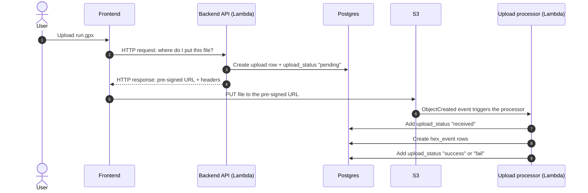
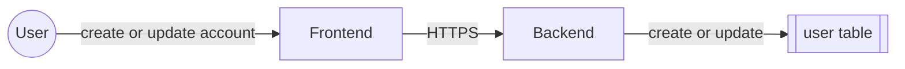
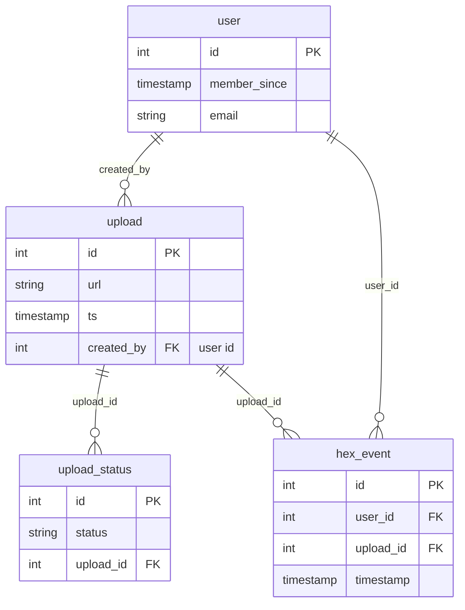
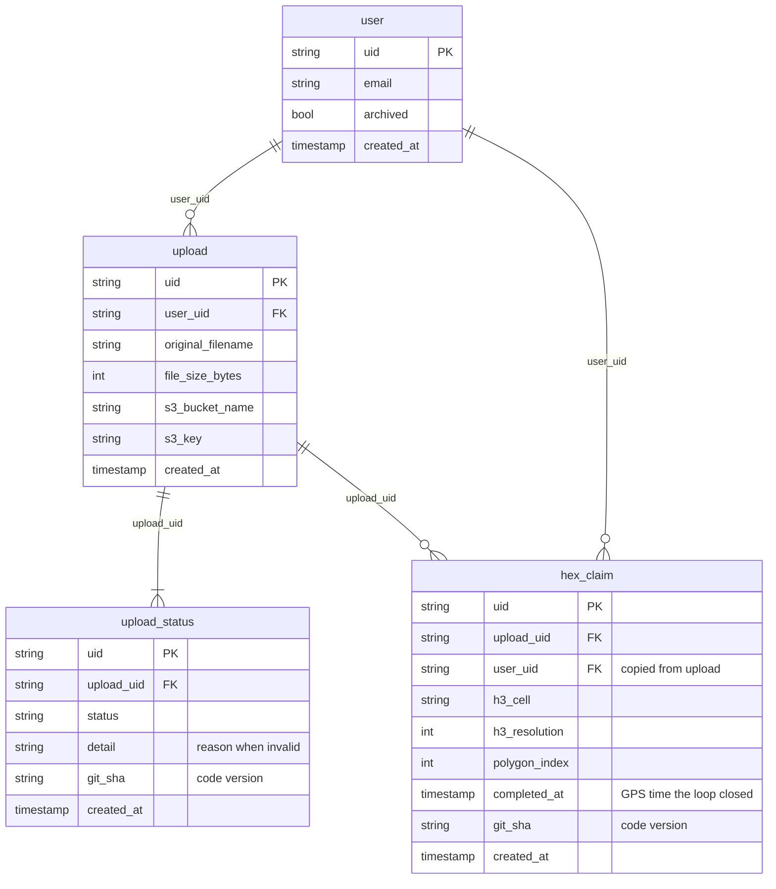

# Upload architecture

How a `.gpx` file gets from a runner's browser into the database, as originally designed and as it works today. Combines two earlier sources: [`upload-architecture.excalidraw`](archive/upload-architecture.excalidraw) (March 2026) and the `ho.md` note ([archived copy](archive/ho.md)).

> **Status: historical design.** The first half of this page shows the original AWS version, where the backend and the upload processor were AWS Lambda functions and files went to S3. The Lambdas were removed on 12 June 2026. [How it works today](#how-it-works-today) covers what changed.

## The upload flow as designed

| Step | What happens | In plain terms |
| --- | --- | --- |
| 1 | User interacts with the frontend | The user clicks through the web page to upload `run.gpx` |
| 2 | Frontend → backend API (HTTP request) | The frontend asks the backend where to put the file |
| 3 | Backend API → database | The backend creates an `upload` record and an `upload_status` row marked *pending* |
| 4 | Backend API → frontend (HTTP response) | The backend replies with a pre-signed URL and the headers the upload must carry |
| 5 | Frontend → S3 | The frontend uploads the file to the location the URL points to |
| 6 | S3 → upload processor | The file landing in S3 triggers the backend's Python code |
| 7 | Upload processor → database | Adds an `upload_status` row marked *received* |
| 8 | Upload processor → database | Downloads and parses the file, then creates the `hex_event` records |
| 9 | Upload processor → database | Adds an `upload_status` row marked *success* or *fail* |

The earlier Excalidraw drawing had a shorter version of steps 6–9: the processor set the status to `PROCESSING` and fetched the file with `GetObject`, both marked "not yet implemented" at the time.

### Notes

- **HTTP request and response (steps 2 and 4)** are two halves of one round trip. The frontend asks where to upload the file; the backend replies on the same connection with the URL. HTTP is the protocol both sides speak; HTTPS is the secure version of it.
- **`upload_status` is a lifecycle log.** It is written to repeatedly (*pending*, *received*, then *success* or *fail*), so it is a running record of where each upload is, not a single field that gets overwritten.
- **The file goes straight from the browser to S3 (step 5)**, not through the backend. This is a common pattern that keeps large file transfers off the backend.

## The account flow as designed

Accounts were originally created with an email and password. Sign-in is now passwordless (an emailed one-time link); see [`auth-architecture.md`](auth-architecture.md).

## The database schema as designed

## How it works today

| Part | As designed | In the current code |
| --- | --- | --- |
| Backend | AWS Lambda | FastAPI server on the Mac mini (k3s); `apps/backend/src/app/routers/uploads.py` |
| File storage | S3 | Tigris in production, SeaweedFS locally; both speak the S3 protocol |
| Step 6 trigger | S3 `ObjectCreated` event starts a Lambda | **Missing.** Nothing calls `process_upload` (`apps/backend/src/app/services/upload.py`); a background worker is planned (TASK-0016) |
| Status values | pending, received, success, fail | `UPLOAD_PENDING`, `UPLOAD_RECEIVED`, `UPLOAD_SUCCESS`, `UPLOAD_INVALID`; one new `upload_status` row per change |
| Hexagon records | `hex_event`, one row per event | `hex_claim`, one row per hexagon per loop, plus the `hex_claim_by_cell` view |
| Keys | Integer `id` | String `uid` (a time-ordered UUID) on every table |

Steps 1–5 work today, locally and in production. Steps 7–9 are implemented in `process_upload` but never run, because step 6 is missing.

### The schema today

`user` also has a `password_hash` column left over from password sign-in (due for removal, TASK-0021). For the full current picture, see [`hexagone-explained.md`](hexagone-explained.md#how-data-moves-through-it).

## Terminology

- **Frontend or client:** the part of the app the user sees and interacts with. A web frontend is one kind of client.
- **Backend:** the server-side code that does the work behind the scenes.
- **Request:** a message the frontend sends, asking the backend to do something or return information.
- **Response:** the backend's reply to a request.
- **Pre-signed URL:** a short-lived link that allows one specific file upload or download, without handing out storage credentials.
