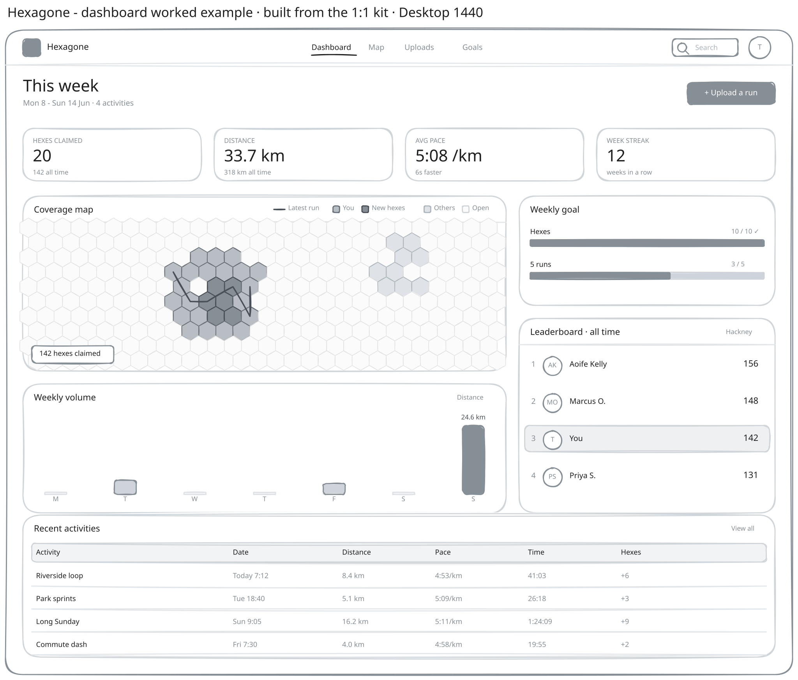
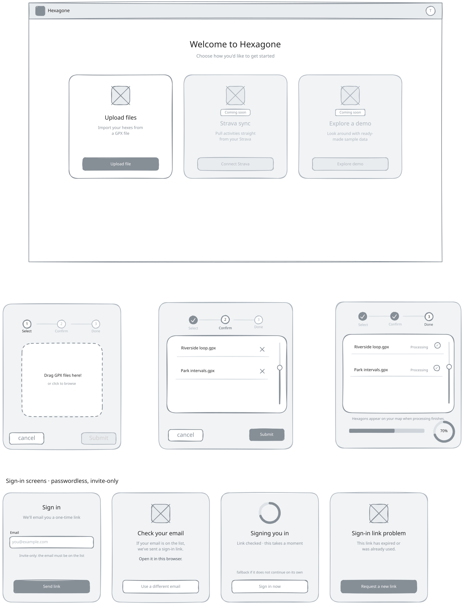
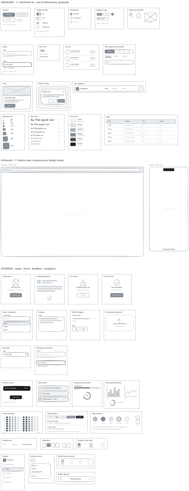

# Design resources

Low-fidelity wireframes for designing Hexagone screens. Each file is an `.excalidraw.svg`: an image that GitHub and VS Code display directly, with the editable Excalidraw drawing embedded inside it.

## Files

| File | What it is |
| --- | --- |
| [`hexagone-wireframe-kit.excalidraw.svg`](hexagone-wireframe-kit.excalidraw.svg) | A reusable, greyscale wireframe component kit at **1:1 scale** (real UI dimensions). Atoms → molecules → organisms, plus design tokens (spacing / type / grey scales) and 1:1 device artboards (Desktop 1440×900, Mobile 390×844). Includes an extended set: states (empty / loading / error / success), form controls, feedback and data-viz, and navigation. |
| [`hexagone-dashboard-example.excalidraw.svg`](hexagone-dashboard-example.excalidraw.svg) | A worked example: a future Hexagone dashboard composed inside the desktop artboard using the kit's components. |
| [`new-user-landing-options.excalidraw.svg`](new-user-landing-options.excalidraw.svg) | The new-user welcome screen (upload, Strava, demo), the three-step upload modal (Select → Confirm → Done), and the four passwordless sign-in screens. |

The original `.excalidraw` files from before the SVG conversion are kept in [`archive/`](archive/) for reference. They are out of date; edit the SVGs instead.

## Previews

### Dashboard example

Most of this dashboard is a design, not the current app. Today the app has two pages, **Map** and **Uploads**. Several widgets need data the backend doesn't store yet:

| Widget | Buildable from today's data? |
| --- | --- |
| Hexes claimed, coverage map ("You") | Yes: the `hex_claim_by_cell` view |
| Weekly goal (hexes), week streak | Mostly: counts from `hex_claim`, once "week" is defined by upload date or run date (`completed_at`) |
| Distance, average pace, weekly volume, run times | No: distance and duration aren't calculated or stored when a run is processed |
| "Others" on the map, leaderboard | No: users can only see their own data, there is no rule for who holds a contested hexagon, and no location (e.g. "Hackney") is stored |

### New-user welcome, upload modal and sign-in

"Strava sync" and "Explore a demo" are roadmap items, so both are dimmed with a "Coming soon" badge, as in the app. The upload modal matches the app's three steps; its Done step shows each file as "Processing", because hexagons only appear once processing finishes. The sign-in screens follow the app's passwordless flow: request a link, check your email, signing in, and a bad or expired link.

### Wireframe kit

## Editing

- **In VS Code:** install the [Excalidraw extension](https://marketplace.visualstudio.com/items?itemName=pomdtr.excalidraw-editor) (`pomdtr.excalidraw-editor`), then open any `.excalidraw.svg` file to edit it in place. Saving updates both the drawing and the image.
- **In a browser:** open [excalidraw.com](https://excalidraw.com) and drag the `.excalidraw.svg` file onto the canvas. To save, use **Export image → SVG** with **Embed scene** ticked, and keep the `.excalidraw.svg` file name.

Without "Embed scene", the export is a plain picture that can no longer be edited.

Each component is **grouped**, so a single click-drag selects the whole thing. Select one and **Add to library** to reuse it across drawings.

## Conventions

- **Greyscale only.** Wireframing in greyscale forces hierarchy to come from size, weight and spacing rather than colour, the core lesson from [Refactoring UI](https://www.refactoringui.com/).
- **1:1 dimensions.** Buttons ~120×40, inputs ~290×40, 14px body text, 40px avatars, so kit components drop straight into the device artboards without rescaling.
- **Tokens:** spacing `4 · 8 · 12 · 16 · 24 · 32 · 48 · 64`; type `30 / 24 / 20 / 18 / 16 / 14 / 13 / 12` (body 14, caption 12); a 6-step grey ramp with roles.
- **Navigation labels:** use the app's page names (Map, Uploads), plus planned pages (Dashboard, Goals) where a design needs them.

## Kit additions for Hexagone

Beyond the generic components, the kit's extended section includes two Hexagone-specific ones:

- **Upload status:** the states a file goes through after the transfer (Pending, Processing, Processed, Invalid), with an invalid file showing its real reason (file too large, invalid GPX, too many trackpoints, loops or hexagons).
- **Map hexagons:** a cell in each state (yours, newly claimed, someone else's, contested, recently lost), in the same tones as the dashboard's coverage-map legend, plus zoom controls. "Contested" and "recently lost" are proposals: the app has no rule for them yet.
